# Mojud (মজুদ)

[](https://github.com/Al-Mahamud/online-seller-saas/actions/workflows/ci.yml)
[](https://github.com/Al-Mahamud/online-seller-saas/actions/workflows/deploy.yml)

**Inventory, orders and cash-on-delivery tracking for Bangladesh's online sellers.**

Mojud is a multi-tenant SaaS for F-commerce sellers: businesses that sell through Facebook pages and WhatsApp, ship by courier and collect cash on delivery. It replaces the notebook and spreadsheet with one place for products, stock, orders, customers, couriers and reports, in Bangla and English, built for a phone first.

> Working name. Release 1 (inventory and orders) is built; release 2 adds an AI inbox for Messenger and WhatsApp. See [Status](#status).

<p align="center">
  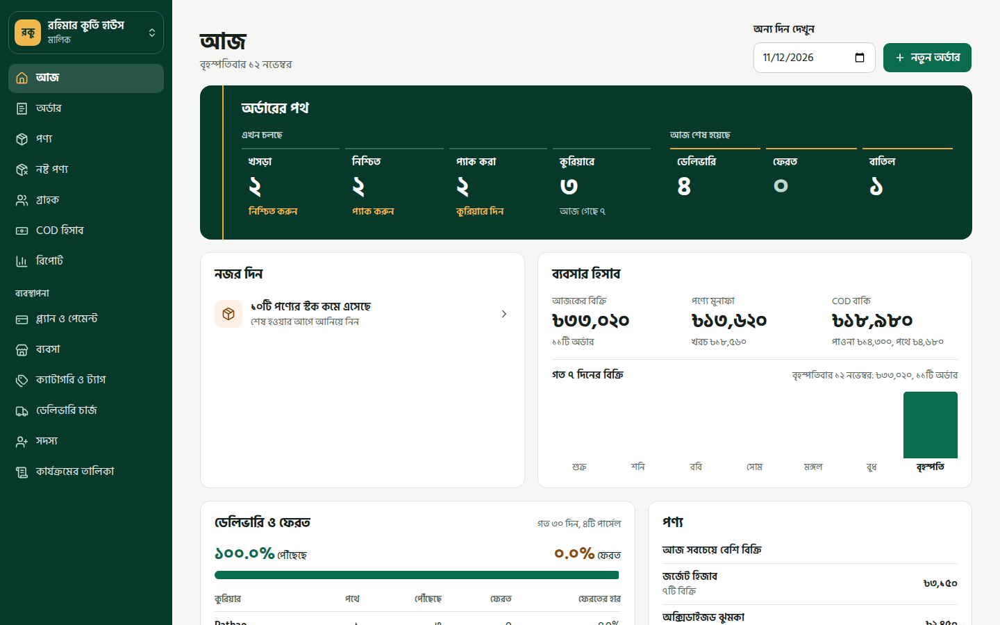
</p>

---

## Contents

- [A day with Mojud](#a-day-with-mojud)
- [Features](#features)
- [Tech stack](#tech-stack)
- [Architecture](#architecture)
- [Repository layout](#repository-layout)
- [Getting started](#getting-started)
- [Testing and quality](#testing-and-quality)
- [Deployment](#deployment)
- [Documentation](#documentation)
- [Status](#status)
- [License](#license)

## A day with Mojud

Follow Rahima, who sells kurtis, saris and jewellery from her Facebook page, through one working day. The screens are in Bangla, the app's default language; every one is also in English. The shop and its customers are demo data, made by `npm run screenshots`.

### 1. Morning: sign in and see the day

Rahima signs in with her user ID and password. **Today** shows where every order stands, from draft to delivered; today's sales, profit and the cash couriers still hold; and what needs her attention, such as stock running low.

<table>
  <tr>
    <td width="50%">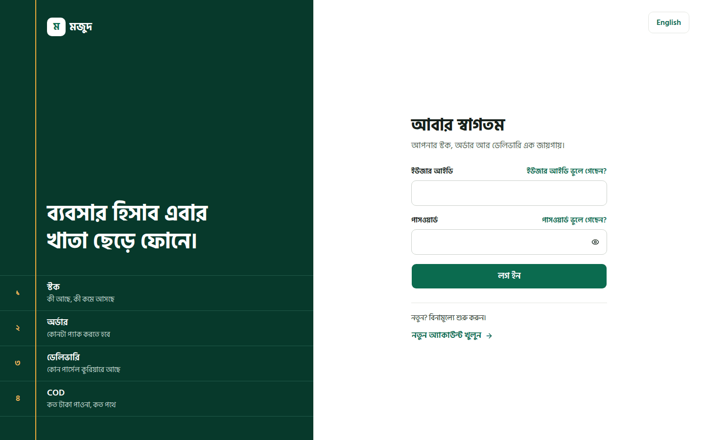</td>
    <td width="50%"></td>
  </tr>
  <tr>
    <td align="center"><sub>Sign in</sub></td>
    <td align="center"><sub>Today</sub></td>
  </tr>
</table>

### 2. Check the shelves

**Products** lists everything she sells, with photos, categories, what is free to sell and a price range across variants. One product shows its stock on hand, what open orders have set aside, and each colour and size with its own price, cost and SKU.

<table>
  <tr>
    <td width="50%">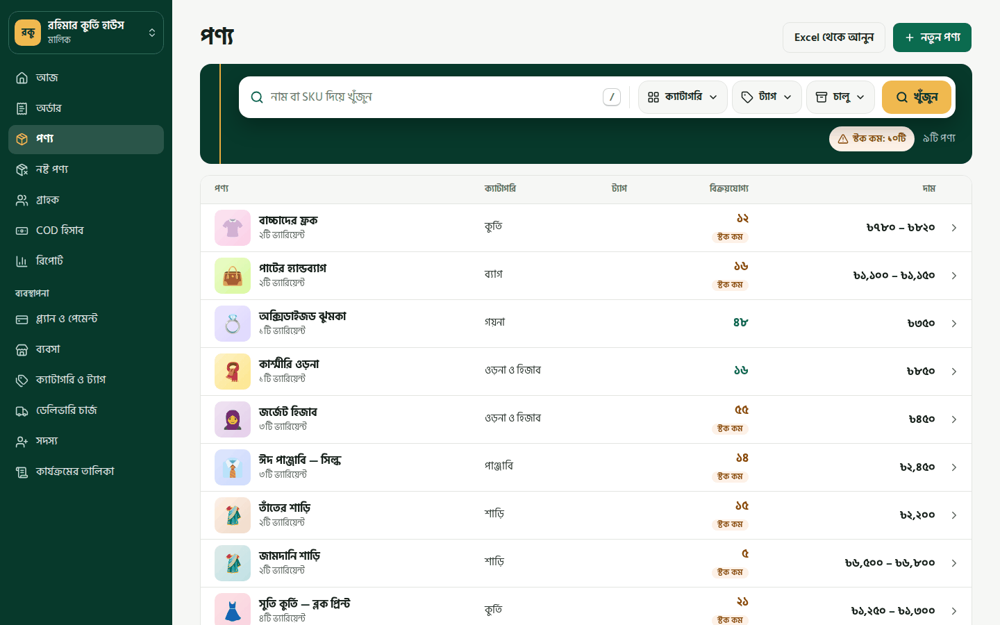</td>
    <td width="50%">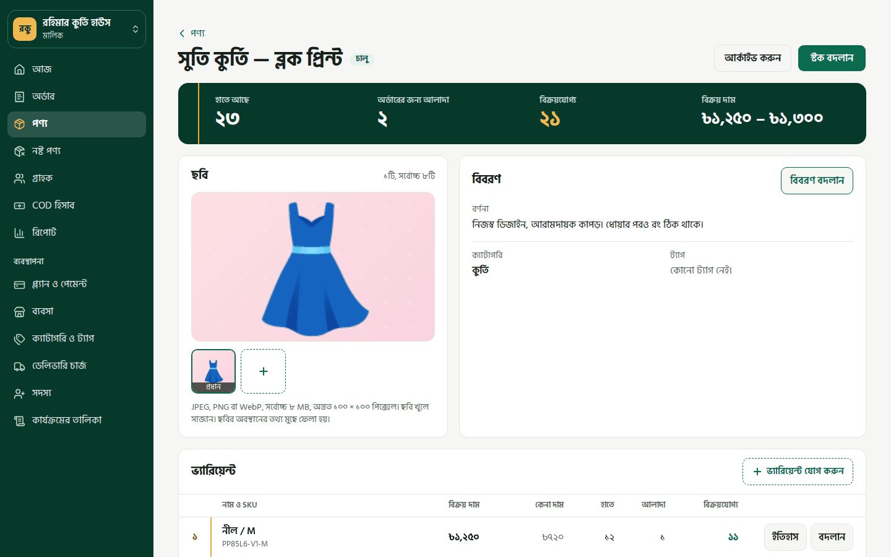</td>
  </tr>
  <tr>
    <td align="center"><sub>Products</sub></td>
    <td align="center"><sub>One product and its variants</sub></td>
  </tr>
</table>

### 3. A customer messages: take the order

A message arrives on Facebook. Rahima types the customer's phone number, and Mojud finds them or adds them. She picks the items; the delivery charge comes from the area, and an advance paid by bKash lowers what the courier must collect. Each order then moves along its path: confirmed, packed, with the courier, delivered.

<table>
  <tr>
    <td width="50%">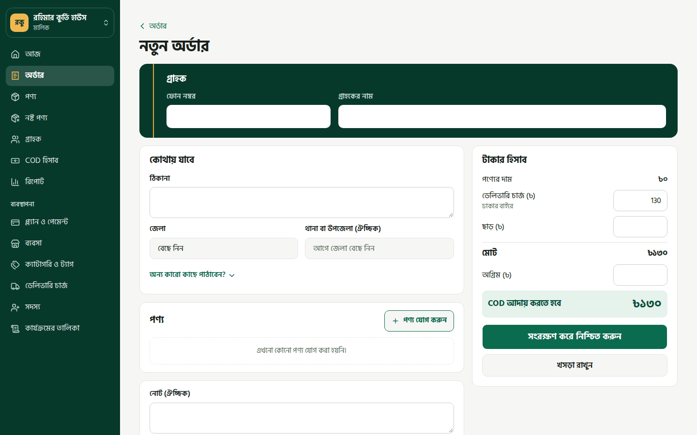</td>
    <td width="50%">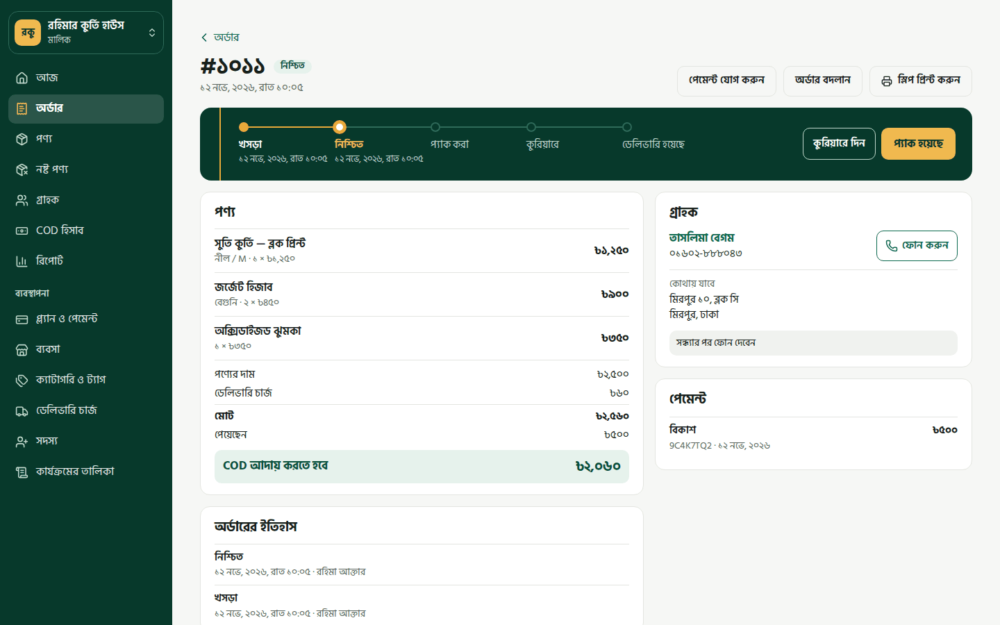</td>
  </tr>
  <tr>
    <td align="center"><sub>New order</sub></td>
    <td align="center"><sub>One order</sub></td>
  </tr>
</table>

### 4. Afternoon: pack and hand to couriers

**Orders** filters by status, so she can select everything confirmed and pack or ship it in one go. **Customers** keeps each buyer's addresses and order history.

<table>
  <tr>
    <td width="50%">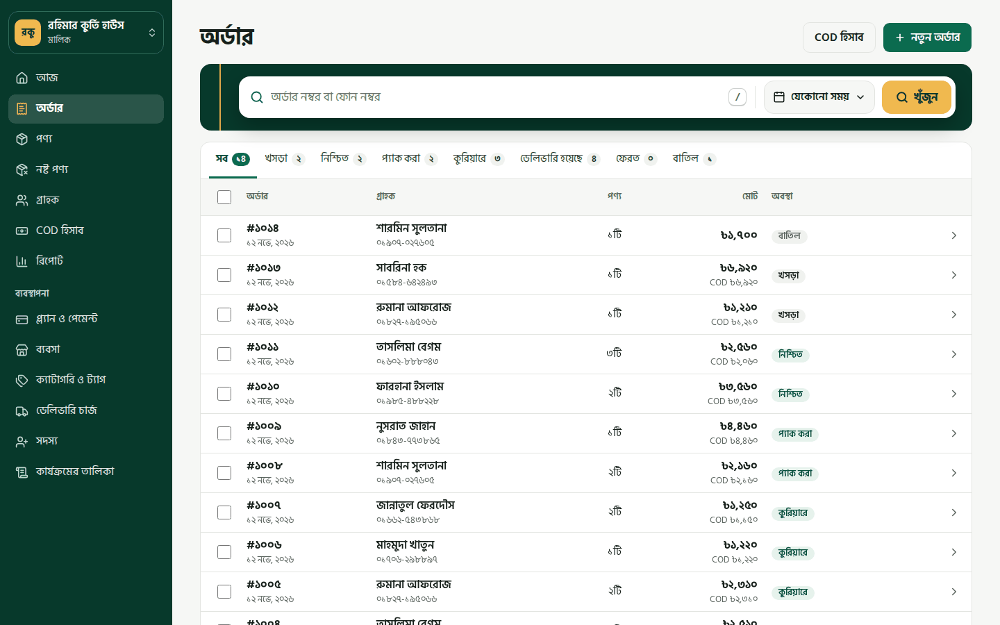</td>
    <td width="50%">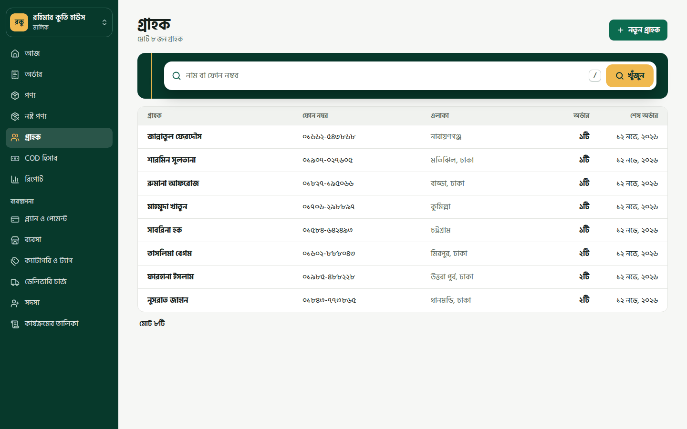</td>
  </tr>
  <tr>
    <td align="center"><sub>Orders</sub></td>
    <td align="center"><sub>Customers</sub></td>
  </tr>
</table>

### 5. Evening: settle the cash

**COD** shows what each courier collected and still owes, and settles a courier's parcels together. **Reports** break sales down by product or category, with profit after costs, returns and courier charges.

<table>
  <tr>
    <td width="50%">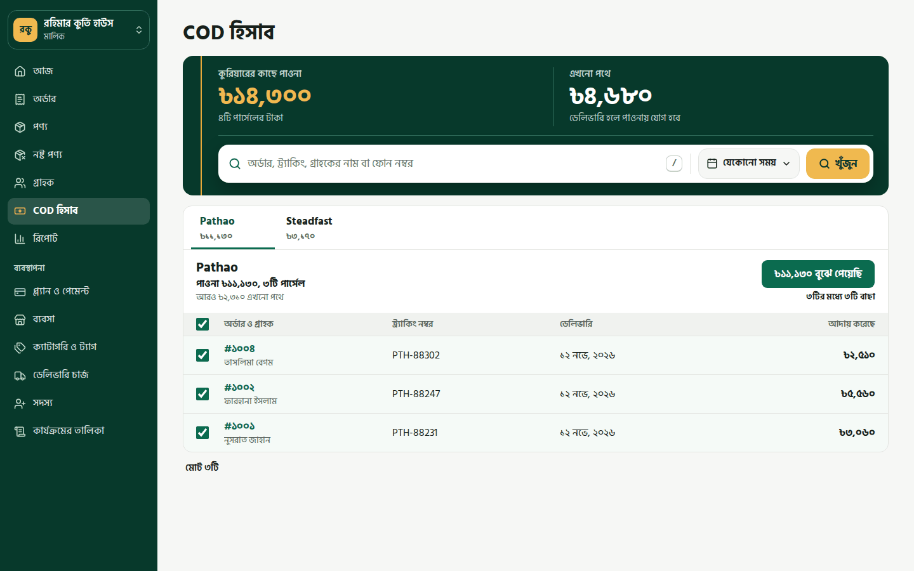</td>
    <td width="50%">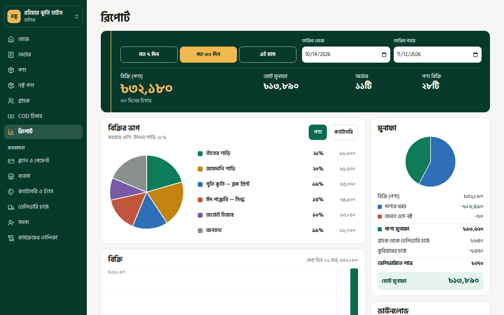</td>
  </tr>
  <tr>
    <td align="center"><sub>Cash on delivery</sub></td>
    <td align="center"><sub>Reports</sub></td>
  </tr>
</table>

### 6. Before closing: restock and write off

**Running low** lists the variants to reorder, and stock can be received there. **Damaged goods** records stained or broken items and what they cost. **Plans** shows how much of her plan she is using.

<table>
  <tr>
    <td width="33%">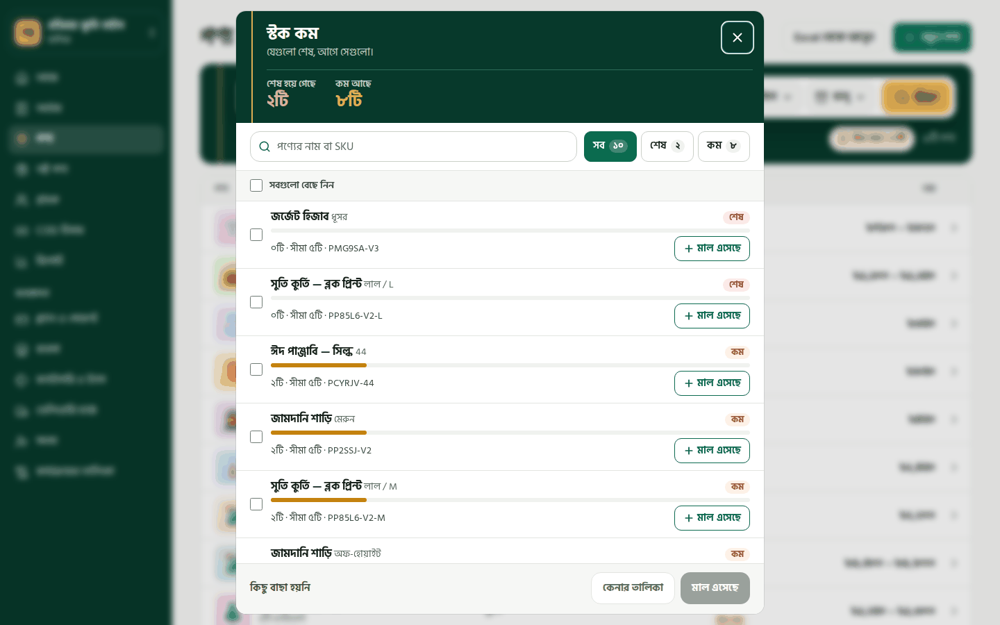</td>
    <td width="33%">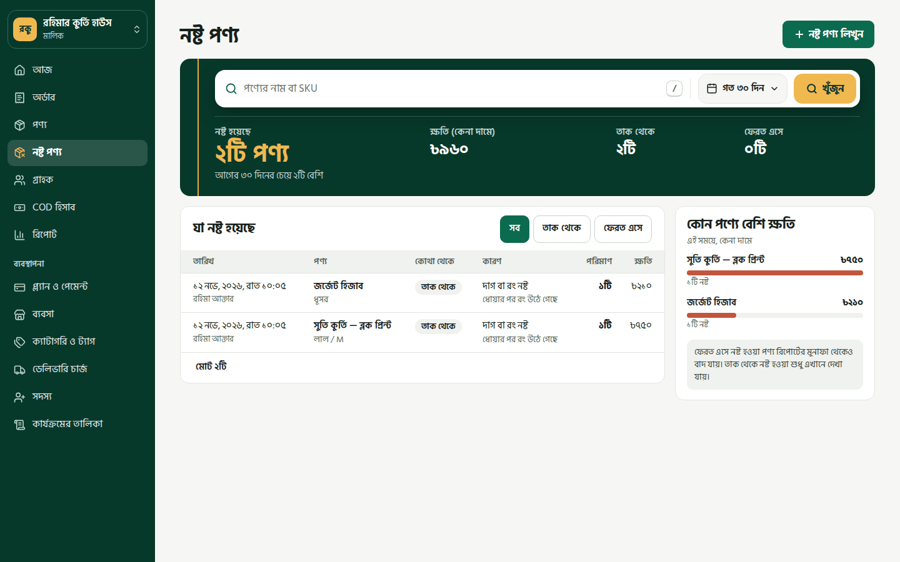</td>
    <td width="33%">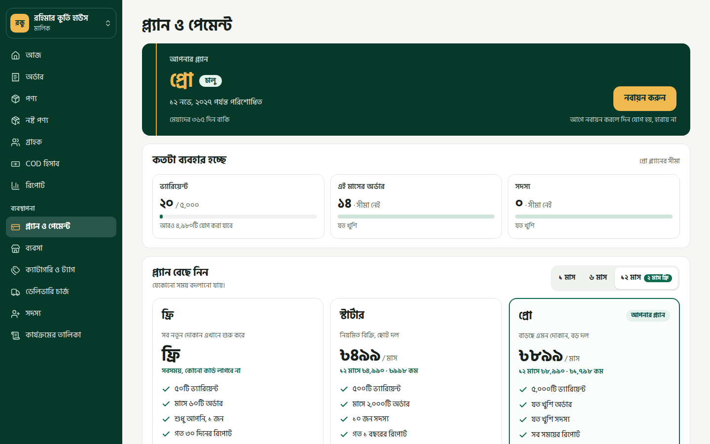</td>
  </tr>
  <tr>
    <td align="center"><sub>Running low</sub></td>
    <td align="center"><sub>Damaged goods</sub></td>
    <td align="center"><sub>Plans and payment</sub></td>
  </tr>
</table>

### On the phone

Most sellers work from a phone, so every screen is built for one first, with the main pages one tap away at the bottom.

<p align="center">
  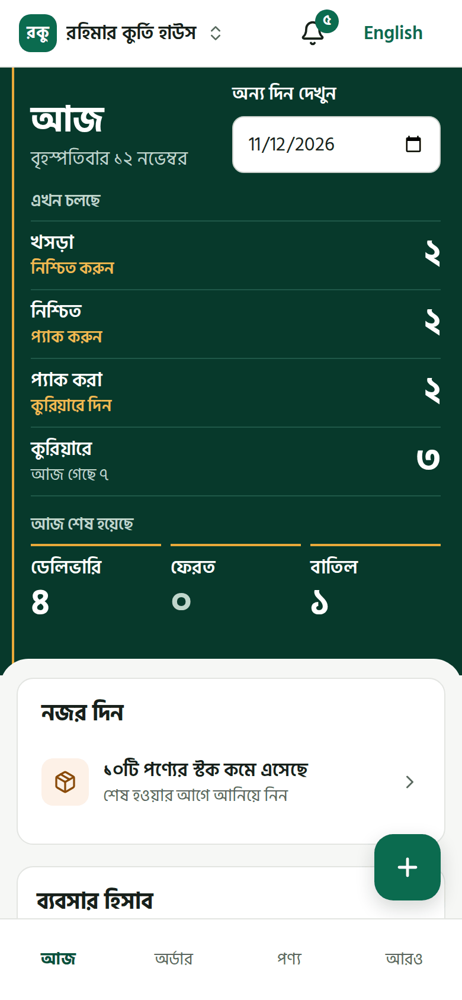
  &nbsp;
  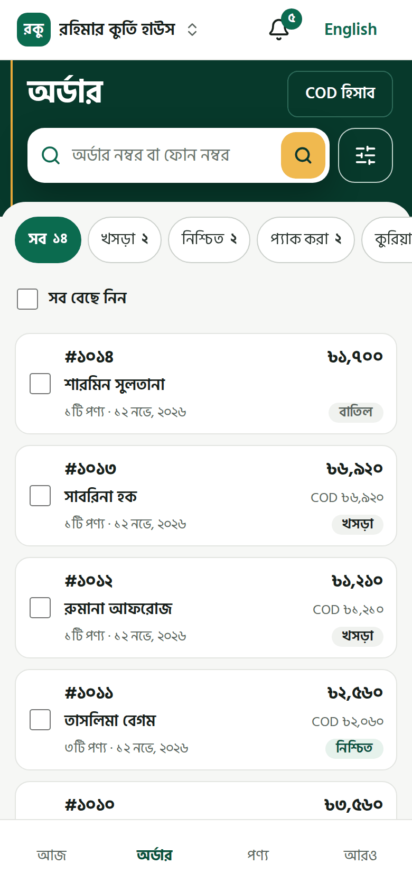
  &nbsp;
  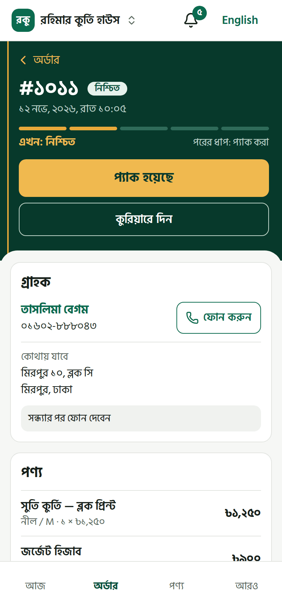
</p>

## Features

| Area | What sellers get |
|---|---|
| **Products** | Products with variants (size, colour…), SKUs, prices and costs, images, categories and tags; bulk import from Excel or CSV with a preview and an error report. |
| **Stock** | A stock ledger for every change, reserve-or-deduct on confirmation, low-stock alerts, a damaged-goods page and a nightly consistency check. |
| **Orders** | Draft → confirmed → packed → shipped → delivered, with returns, partial deliveries, re-shipping, bulk pack and ship, and printable packing slips. |
| **Payments and COD** | Advances by bKash, Nagad, Rocket, bank or cash; what each courier still owes; settling COD per courier. |
| **Customers and delivery** | Customers found by phone however it is written; Bangladesh divisions, districts and areas; delivery charges by zone. |
| **Reports** | A "today" dashboard, sales and profit over time, best sellers, and downloads on the Pro plan. |
| **Team** | The owner creates staff and manager logins; roles decide who sees costs and profit; an activity log of every change. |
| **Plans and billing** | Free, Starter (৳499 a month) and Pro (৳899 a month), with limits enforced by the server and payment through SSLCommerz. |
| **Platform admin** | Business management, metrics and data-rights requests, behind two-step sign-in. |
| **Language** | Every screen and error message in Bangla and English, with Bangla digits and search that matches Bangla however it is typed. |

## Tech stack

| Layer | Technology |
|---|---|
| **Backend** | Java 17, Spring Boot 4.1, Spring Modulith, Spring Security with JDBC sessions, Spring Data JPA, Flyway, db-scheduler, springdoc OpenAPI |
| **Database** | PostgreSQL 18 (14 or later required), with row-level security for tenant isolation and `pg_trgm` for search |
| **Frontend** | React 19, TypeScript, Vite, TanStack Router and Query, Tailwind CSS 4, shadcn/ui on Radix, React Hook Form with Zod, i18next |
| **API contract** | OpenAPI, with TypeScript types generated for the frontend (`openapi-fetch`) |
| **Files** | S3-compatible storage (Cloudflare R2 on servers, the local disk in development) |
| **Payments** | SSLCommerz |
| **Testing** | JUnit 5 with embedded PostgreSQL and GreenMail; Vitest and Testing Library; Playwright with axe accessibility checks |
| **Operations** | Docker Compose, Caddy (HTTPS), Jib images on GHCR, encrypted nightly backups to R2, Sentry, GitHub Actions |

## Architecture

The backend is a modular monolith. Each business area is a [Spring Modulith](https://spring.io/projects/spring-modulith) module that talks to others only through their public interfaces and events, and a test fails if a module reaches into another's internals.

```
com.mojud
├── identity        sign-up, sign-in, sessions, two-step sign-in
├── tenancy         businesses, members, roles
├── catalog         products, variants, categories, tags, search
├── inventory       stock ledger, reservations, low-stock alerts
├── importing       Excel and CSV product import
├── customers       customers and their history
├── delivery        geography and delivery zones
├── orders          orders, shipments, payments, returns, packing slips
├── reporting       dashboard and reports
├── billing         plans, limits, subscriptions, SSLCommerz
├── notifications   email and in-app notifications
├── files           image upload and storage
├── audit           activity log
├── admin           platform administration
└── shared          web, logging, errors and other common code
```

**Multi-tenancy.** Every business's rows carry its ID, and PostgreSQL row-level security enforces the boundary: the app connects through a role that can only see the current business. A cross-tenant test suite checks every endpoint.

**Errors.** Every error is an RFC 9457 problem response with a stable `code` (see `ErrorCode`) and a `detail` in English or Bangla, chosen by `Accept-Language`.

**Logging.** Each request has an ID that appears in every log line and in Sentry, and the app shows it to sellers as "কোড: …" so support can find the request. Secrets are masked. See [docs/logging.md](docs/logging.md).

## Repository layout

```
.
├── backend/     Spring Boot API (Maven)
├── frontend/    React web app (Vite)
├── deploy/      Docker Compose, Caddy, backup and restore scripts
├── docs/        Plans, page designs and runbooks
└── .github/     CI, deploy drill, dependency scan, uptime check
```

## Getting started

### Prerequisites

- **JDK 17.** Maven comes with the wrapper (`./mvnw`).
- **Node 22.12 or later**, with npm.
- No database or Docker is needed for development: the backend starts an embedded PostgreSQL.

### Backend

```sh
cd backend
./mvnw spring-boot:test-run      # the API on http://localhost:8080
./mvnw verify                    # build and run every test
```

`spring-boot:test-run` starts `TestMojudApplication` with the `local` profile: an embedded PostgreSQL set up with the same three roles as production (`src/main/resources/db/bootstrap/roles.sql`), and a fresh database on every start.

| URL | What |
|---|---|
| `/healthz` | Health check |
| `/api/docs` | Swagger UI. Call `GET /api/v1/auth/csrf` once first so that POST, PUT and DELETE are accepted. |
| `/api/v1/openapi` | OpenAPI JSON |
| `/dev/otp?to=01712345678` | The last one-time code sent to that number. Codes are logged, not sent, on local runs. |

**In IntelliJ IDEA:** open the `backend` folder (it imports as a Maven project), set the project SDK to JDK 17, and run `TestMojudApplication` from `src/test/java/com/mojud`. Don't run `MojudApplication` directly: it expects a real PostgreSQL and its passwords.

**Against a real PostgreSQL:** run `roles.sql` once as a superuser, create the database (`CREATE DATABASE mojud OWNER mojud_owner`), and set `DB_URL`, `DB_OWNER_PASSWORD`, `DB_APP_PASSWORD` and `DB_SYSTEM_PASSWORD`.

**Platform admins** are set in the database, on purpose with no screen for it.
- Locally: `curl -X POST "http://localhost:8080/dev/platform-admin?phone=01712345678"`.
- On a server: as the system role, run `update users set is_platform_admin = true where phone = '+8801712345678';`. The person then signs in again and turns on two-step sign-in, which servers require for the admin area.

### Frontend

Start the backend first, then:

```sh
cd frontend
npm install       # once, and after package.json changes
npm run dev       # http://localhost:5173, with /api sent to port 8080
```

## Testing and quality

### Backend

`./mvnw verify` runs unit, integration and module-structure tests against an embedded PostgreSQL, plus snapshot tests for the OpenAPI document and generated files such as packing slips (update snapshots with `-DupdateSnapshots=true`).

### Frontend

| Command | What it does |
|---|---|
| `npm test` | Unit tests (Vitest) |
| `npm run lint` / `npm run format` | Check or fix style and lint (Biome) |
| `npm run typecheck` | TypeScript |
| `npm run build`, then `npm run size` | Production build in `dist/`, and its size budget |
| `npm run e2e` | End-to-end tests in Chromium at phone and laptop sizes (Playwright). They start the test backend and the built app themselves. Run `npx playwright install chromium` once first. |
| `npm run perf` | First and return visits timed on a slow phone and connection. Run by hand, since the timings depend on the machine. |
| `npm run api:types` | Regenerate `src/api/schema.d.ts` from `src/api/openapi.json` |
| `npm run texts:review` | Export every text, English beside Bangla, to `docs/bangla-review.csv` |
| `npm run screenshots` | Retake the README's screenshots in `docs/screenshots/` with a fresh demo shop. Needs the test backend and `vite preview` running, as for `npm run e2e`. |

### Continuous integration

| Workflow | When | What |
|---|---|---|
| **CI** | Pushes to `main` and every pull request | Backend tests; frontend lint, types, tests, build and size budget; end-to-end tests; backend and web images from `main` |
| **Deploy check** | Every change and monthly | Brings up the full Compose stack, then backs it up and restores it |
| **Dependencies** | Weekly | Known-vulnerability scan; Dependabot raises update pull requests |
| **Uptime** | Every 10 minutes | Checks the live `/healthz` |

### Common tasks

- **When the API changes:** `OpenApiSnapshotTests` fails and rewrites `frontend/src/api/openapi.json`. Run `npm run api:types` and commit both files.
- **Adding a UI component:** run `npx shadcn@4.23.0 add <name>`; the source lands in `src/components/ui/`, where it is ours to change.
  - Answer "no" if it offers to overwrite `button.tsx` or `sonner.tsx`, which have local changes.
  - The tool imports `cn` from an npm package of that name. Run `npm uninstall cn` and change the import to `@/lib/utils`.

## Deployment

One Ubuntu server with Docker runs the whole system: PostgreSQL, the backend, Caddy serving the web app over HTTPS, and a nightly encrypted backup to Cloudflare R2. Uploaded images live in their own R2 bucket, so a lost server can be fully restored.

- [deploy/README.md](deploy/README.md): setting up a server, updating, backups and restoring
- [docs/operations.md](docs/operations.md): the day-to-day runbook, background jobs, rotating secrets and what to do when something is wrong

## Documentation

| Topic | Document |
|---|---|
| Product | [Product plan](docs/product-plan.md) · [Plans and payment](docs/plans-and-payment.md) |
| Engineering plans | [Backend plan](docs/backend-plan.md) · [Implementation plan](docs/implementation-plan.md) · [Frontend plan](docs/frontend-plan.md) |
| Running it | [Deployment](deploy/README.md) · [Operations](docs/operations.md) · [Logging](docs/logging.md) · [Load test report](docs/load-test-report.md) |
| Conventions | [Pagination](docs/pagination.md) · [Search panel](docs/search-panel.md) · [Bangla text review](docs/bangla-review.csv) |
| Pages | [Today](docs/dashboard-redesign.md) · [Orders](docs/orders-redesign.md) · [Products](docs/product-redesign.md) · [Customers](docs/customers-redesign.md) · [Reports](docs/reports-redesign.md) · [Damaged goods](docs/damages.md) · [Running low](docs/low-stock.md) · [Categories](docs/categories.md) · [Delivery charges](docs/delivery-charges.md) · [Business](docs/business-page.md) · [Team](docs/team.md) · [Activity log](docs/activity-log.md) · [Sidebar](docs/sidebar-redesign.md) · [Sign-in](docs/auth-redesign.md) · [Admin](docs/admin-panel.md) |

## Status

| Part | Status |
|---|---|
| Backend: 13 phases, from foundation to launch readiness | Built. The first run on a real server is still to come. |
| Web app: F0–F10 | Built |
| Launch polish (F11) | In progress: a Bangla read-through, sessions with sellers and a Sentry project remain |
| SSLCommerz | Built against a test double. Waiting for store credentials to run against the real sandbox. |
| Release 2: AI inbox for Messenger and WhatsApp | Planned. See the [product plan](docs/product-plan.md#ai-agent-design). |

Progress by phase is tracked in the [implementation plan](docs/implementation-plan.md#status) and the [frontend plan](docs/frontend-plan.md#phases).

## License

Copyright © 2026 Al Mahamud. **All rights reserved.** The code is public so it can be read and evaluated. It may not be copied, run or reused without written permission. See [LICENSE](LICENSE).
